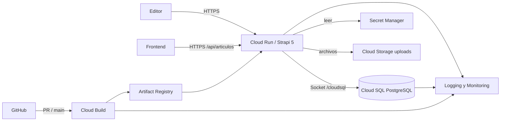

# 1. Arquitectura

Cloud Run usa la URL HTTPS nativa, mínimo cero y máximo una instancia. Cloud SQL
PostgreSQL 16 guarda artículos y usuarios. El acceso a SQL desde Run usa el conector
integrado y socket Unix; no se necesitan VPC, Cloud NAT ni balanceador. El bucket
GCS versionado guarda el estado Terraform; otro bucket privado conserva los
uploads del CMS. No se usa Redis porque la demostración no necesita caché.

**Límite de compatibilidad:** Strapi documenta PostgreSQL como motor compatible,
pero declara sin soporte oficial las bases administradas «cloud native», incluida
Cloud SQL. El arranque y CRUD en GCP deben comprobarse antes de la exposición.
