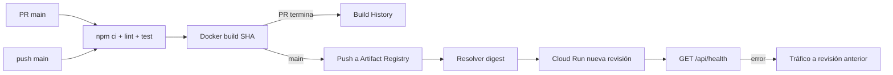

# 3. CI/CD de aplicación



`bootstrap` configura dos triggers de Cloud Build 2nd gen. Ambos usan
`entrega/demo-strapi/cloudbuild.yaml` del repositorio único y una cuenta específica. `_DEPLOY=false` valida PR;
`_DEPLOY=true` publica y despliega `main`. `_DEPLOY=seed` es solo para la imagen
inicial. Solo cambios en `entrega/demo-strapi/**` o `.gcloudignore` activan los
triggers; editar informes o capturas no consume builds. Los logs van a Cloud
Logging y las ejecuciones aparecen en Build History.

El pipeline identifica la revisión que atiende el 100 % del tráfico, despliega por
digest y exige que el endpoint health informe el SHA nuevo. Si falla en 18 intentos,
envía el 100 % del tráfico a la revisión previa y marca el build como fallido.
Rollback manual:

```bash
gcloud run revisions list --service strapi-a5-service --region us-central1
gcloud run services update-traffic strapi-a5-service --region us-central1 --to-revisions=REVISION_ANTERIOR=100
```

La alerta de fallos de Cloud Build usa una métrica basada en logs de error; el estado
definitivo del build debe confirmarse en Build History, ya que un fallo sin línea
de error coincidente puede no incrementar esa métrica.
